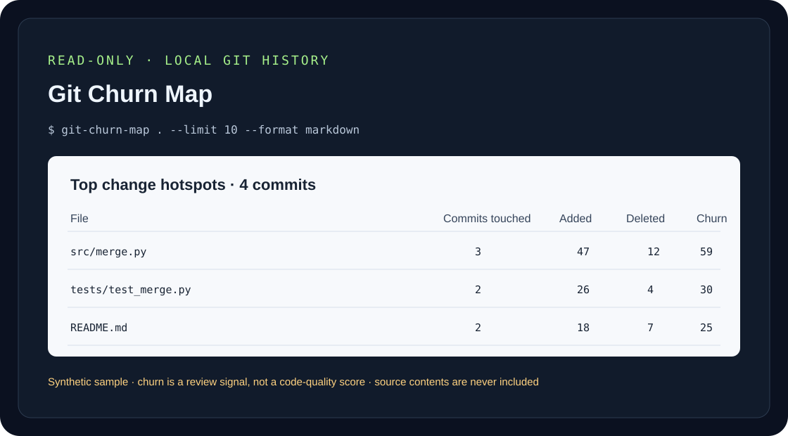

# Git Churn Map

[](https://github.com/GhosTnever-lkm/git-churn-map/actions/workflows/ci.yml)
[](https://github.com/GhosTnever-lkm/git-churn-map/releases)
[](LICENSE)

**Find files that change most often in a local Git repository—so you can prioritize code review and maintenance.** Git Churn Map reads commit metadata and line counts only; it never uploads repository data or includes source contents in reports.



## Who it is for

- Maintainers choosing where to focus a limited review or refactoring budget.
- Teams looking for frequently edited areas before planning a stabilization sprint.
- Developers comparing a recent history window with the full local history.

## Quick start

Requires Python 3.11+ and Git installed and available on `PATH`.

```bash
python -m pip install "git-churn-map @ git+https://github.com/GhosTnever-lkm/git-churn-map.git@v0.1.0"
git-churn-map /path/to/repository --limit 15
```

JSON for scripts:

```bash
git-churn-map . --since "90 days ago" --format json --output churn.json
```

Exclude generated files using repeatable repository-relative globs:

```bash
git-churn-map . --exclude 'vendor/*' --exclude '*.lock' --max-commits 2000
```

## Example output

The checked-in sample is synthetic and illustrative; it is not derived from a user's repository.

```text
# Git Churn Map
Commits scanned: 4

| File             | Commits touched | Added | Deleted | Churn |
|:-----------------|----------------:|------:|--------:|------:|
| src/merge.py     | 3               | 47    | 12      | 59    |
| tests/test_merge.py | 2            | 26    | 4       | 30    |
| README.md        | 2               | 18    | 7       | 25    |
```

- [Open sample report](examples/sample-report.md)
- [See a sample image](docs/demo.svg)

## How it works

1. Runs bounded local `git log` with `--numstat`; the tool does not contact a network or open working-tree source files.
2. Counts non-merge commits, file touches, added lines, and deleted lines; binary-file line counts are omitted.
3. Sorts by total churn (added + deleted), then touches, then path for repeatable output.
4. Writes Markdown or JSON to stdout or a file.

## Scope and limitations

- Default limit: 5,000 non-merge commits; maximum: 50,000. `--max-commits` bounds work; Git commands time out after 60 seconds.
- Rename detection is intentionally disabled, so a rename can appear as a deletion plus an addition.
- Churn is not a complexity, defect, risk, or quality score. Formatting-only edits and generated files can rank highly; use excludes and human judgment.
- Merge commits are omitted. Only local history reachable from the current checkout is considered.
- Git's date parsing is used for `--since` and `--until`.
- Paths with unusual Unicode or control characters are made visible in Markdown; JSON preserves data with valid escaping.

## Tests

```bash
python -m unittest discover -s tests -v
python -m compileall -q src tests
```

CI tests Python 3.11, 3.12, and 3.13. The tool uses the Python standard library at runtime.

## ☕ Support / Pro Version

The core tool is free and open source under MIT. If it saves you time, you can support ongoing maintenance through [Buy Me a Coffee](https://buymeacoffee.com/azizazimov8) or [GitHub Sponsors](https://github.com/sponsors/GhosTnever-lkm). There is no paid edition or paid support promise at this time.

## License

MIT. See [LICENSE](LICENSE).
